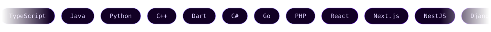
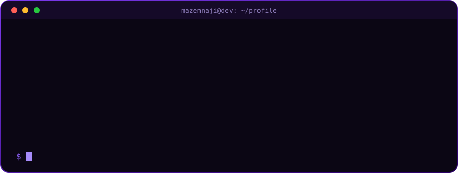

 

  

&nbsp;
&nbsp;
&nbsp;
&nbsp;

&nbsp;
&nbsp;
&nbsp;

  

## About

<table>
<tr>
<td width="46%" valign="middle">

I'm **Mazen**, a software engineer who loses track of time when something is being built. A neural net, a multiplayer server or an end-to-end web app, it makes no difference to me. I take ideas that are still fuzzy and make them fast, solid and long-lived, owning everything from the **interface** to the **API** to the **infrastructure** underneath.

Right now I'm going deep on **reinforcement learning**, **procedural world generation** and **distributed systems**. I read the docs and the source, and I'll happily chase one strange bug at 2am.

- **Building:** AI pipelines, gameplay systems, scalable full-stack products
- **Leveling up:** RL, procedural generation, distributed systems
- **Always down for:** open source, hackathons, ambitious side projects

</td>
<td width="54%" align="center" valign="middle">

</td>
</tr>
</table>

## What I Build

| Domain | Focus |
|:--|:--|
| **Full Stack Engineering** | End-to-end products, responsive frontends, scalable APIs, auth and data modeling, CI/CD |
| **AI Systems** | LLM pipelines, RL agents, computer vision, generative models |
| **Web Platforms** | Real-time apps, micro-frontends, design-system-driven UIs |
| **Mobile and Desktop** | React Native, Flutter, C# WinForms |
| **Game Development** | Gameplay systems, shaders, procedural generation, AI NPCs |
| **Cloud and DevOps** | Containerised services, CI/CD, distributed infrastructure |

## Selected Work

| Project | Stack | What it does |
|:--|:--|:--|
| **CEDAR Chatbot** | Django · Reinforcement Learning | Trilingual chatbot with an RL module that improves responses over time |
| **MindMap AI** | Next.js · React · 3D | Turns PDFs and notes into interactive 3D knowledge maps for studying |
| **LocalLoop** | React Native · Supabase · PostGIS | Hyperlocal neighborhood app with real-time, location-aware features |
| **CineBook** | C# · WinForms | Desktop movie ticket booking application |
| **InventoryManager** | C# · WinForms · SQL Server | Inventory and product management with a SQL Server backend |
| **SensorFlow** | NestJS · Sequelize · Knex.js | Planned IoT sensor platform with batched ingestion and downsampling |

[Browse all repositories](https://github.com/Mazennaji?tab=repositories)

## Tech Arsenal

 

 

 

 

 

 

## How I Work

| Principle | What it means |
|:--|:--|
| **Own the whole stack** | Comfortable from the CSS to the database index |
| **Design for scale early** | Clean boundaries, observable services, no accidental monoliths |
| **Performance is a feature** | Profile first, optimise with evidence |
| **Craft over hype** | Boring, reliable foundations beat trendy rewrites |

## GitHub Stats

  

&nbsp;

  

## Competitive Programming

  

&nbsp;

## Contribution Snake

## Let's Build Something

Got a product idea, an AI experiment, or a game world that needs an engineer?
**I'd love to hear about it.**

 

&nbsp;
&nbsp;

 

> *"The best way to predict the future is to invent it."*
> Alan Kay

Last edited on: 11/16/2026

