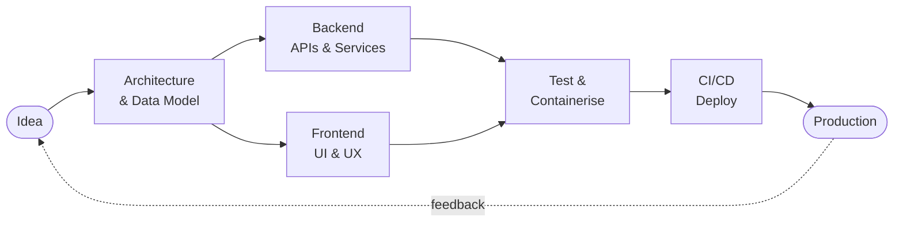

<div align="center">


</div>

<div align="center">


</div>

<br/>

<div align="center">

[](https://mazennaji.dev)&nbsp;
[](https://www.linkedin.com/in/mazen-naji/)&nbsp;
[](https://github.com/Mazennaji)&nbsp;
[](mailto:mazen.naji.1@gmail.com)&nbsp;
[](https://leetcode.com/u/MazenNaji/)&nbsp;
[](https://www.hackerrank.com/profile/mazen_naji_1)

</div>

<div align="center">


&nbsp;

&nbsp;

&nbsp;


</div>

<br/>

<div align="center">

</div>

<br/>

## ◈ Who Am I

```python
#!/usr/bin/env python3
#  engineer.py  ·  Mazen Naji  ·  v∞

class MazenNaji:
    """
    CS Graduate turned Software Engineer & Full Stack Engineer.
    I don't just write code. I build experiences.
    """

    name       : str  = "Mazen Naji"
    role       : str  = "Software Engineer · Full Stack Engineer · AI Engineer"
    origin     : str  = "Lebanon"
    status     : str  = "Building systems that are smart, scalable & immersive"
    stack      : str  = "Frontend → Backend → Database → Cloud → AI"
    learning   : list = [
        "Deep Reinforcement Learning",
        "Procedural World Generation",
        "Distributed Systems at Scale",
    ]
    superpower : str  = "Bridging raw creativity with ruthless technical precision"

    def mission(self) -> str:
        return "Turn ideas → code → experiences that actually matter."

    def philosophy(self) -> str:
        return "Every system I build should outlive the hype that inspired it."

    def fun_facts(self) -> dict:
        return {
            "bugs_fixed"       : "countless (and counting)",
            "coffee_consumed"  : "astronomical",
            "worlds_built"     : "in progress…",
            "sleep_schedule"   : "negotiable",
            "favourite_quote"  : "The best way to predict the future is to invent it.",
        }

if __name__ == "__main__":
    me = MazenNaji()
    print(me.mission())
```

<br/>

---

<br/>

## ◈ About Me

<table>
<tr>
<td width="60%" valign="middle">

I'm **Mazen**, a software engineer and **full stack engineer** who loses track of time when I'm building. It could be a neural net, a multiplayer game server, or an end-to-end web app. I love taking an idea that's still fuzzy in someone's head and making it real, fast, and solid enough to last. I'm happy owning everything from the **interface** to the **API** to the **infrastructure** underneath.

Right now I'm deep in **Deep Reinforcement Learning** and **procedural world generation**, and slowly leveling up my **distributed systems** game. I'm the kind of person who reads the docs *and* the source code, and who'll happily fall down a rabbit hole at 2am chasing one weird bug.

I also genuinely enjoy contributing to open source and collaborating with people who care about craft as much as I do. If that's you, my inbox is open.

- **Currently building:** AI pipelines, gameplay systems & scalable full-stack products
- **Currently leveling up:** RL, procedural generation, distributed systems
- **Always down for:** open-source collabs, hackathons, ambitious side projects
- **Fun fact:** my sleep schedule is best described as "negotiable"

</td>
<td width="40%" align="center">


</td>
</tr>
</table>

<br/>

---

<br/>

## ◈ Tech Arsenal

<br/>

<div align="center">

### ◈ Languages


<br/>

<br/>


<br/><br/>

### ◈ Web & Backend


<br/>

<br/>


<br/><br/>

### ◈ Databases


<br/>
&nbsp;

<br/><br/>

### ◈ Cloud, DevOps & AI


<br/><br/>

### ◈ Mobile


<br/><br/>

### ◈ Game Development


<br/><br/>

### ◈ Tools & Environment


</div>

<br/>

---

<br/>

## ◈ What I Build

<div align="center">

| Domain | What I Do |
|:--|:--|
| **Full Stack Engineering** | End-to-end products · responsive frontends · scalable APIs · auth & data modeling · CI/CD to production |
| **AI Systems** | LLM pipelines · RL agents · computer vision · generative models |
| **Web Platforms** | Real-time apps · micro-frontends · edge deployments · design-system-driven UIs |
| **Game Development** | Gameplay systems · shader programming · procedural generation · AI NPCs |
| **Mobile** | Cross-platform apps with Flutter & React Native |
| **Cloud & DevOps** | Containerised microservices · CI/CD · distributed infrastructure |

</div>

<br/>

---

<br/>

## ◈ How I Ship

<div align="center">



</div>

<br/>

<div align="center">

| ◈ Principle | What it means |
|:--|:--|
| **Own the whole stack** | I'm comfortable from the CSS to the database index, and everything in between |
| **Design for scale early** | Clean boundaries, observable services, no accidental monoliths |
| **Performance is a feature** | Profile first, optimise with evidence, ship fast experiences |
| **Craft over hype** | Boring, reliable foundations beat trendy rewrites |

</div>

<br/>

---

<br/>

## ◈ GitHub Stats

<div align="center">

<a href="https://github.com/Mazennaji" target="_blank">
  
</a>

<br/><br/>


&nbsp;


<br/><br/>


</div>

<br/>

---

<br/>

## ◈ Competitive Programming

<div align="center">

<a href="https://leetcode.com/u/MazenNaji/" target="_blank">
  
</a>

<br/><br/>

| Platform | Focus Areas | Link |
|:--|:--|:--:|
| **LeetCode** | Data Structures · Algorithms · Weekly Contests | [](https://leetcode.com/u/MazenNaji/) |
| **HackerRank** | Problem Solving · Certifications · Rankings | [](https://www.hackerrank.com/profile/mazen_naji_1) |

</div>

<br/>

---

<br/>

## ◈ Contribution Snake

<div align="center">


</div>

<br/>

---

<br/>

## ◈ Let's Build Something

<div align="center">

Got a product idea, an AI experiment, or a game world that needs an engineer?<br/>
**I'd love to hear about it.**

<br/>

[](mailto:mazen.naji.1@gmail.com)&nbsp;
[](https://www.linkedin.com/in/mazen-naji/)&nbsp;
[](https://mazennaji.dev)

</div>

<br/>

---

<br/>

<div align="center">

> *"The best way to predict the future is to invent it."*
>
> Alan Kay

</div>

<br/>

<div align="center">


&nbsp;

&nbsp;

&nbsp;


</div>

<br/>

<div align="center">
<sub><i>The universe is written in the language of code. &nbsp;I am fluent.</i></sub>
</div>

<br/>

<hr>

<div align="center">
<sub>Credit: <a href="https://github.com/Mazennaji">Mazen Naji</a></sub>
<br/>
<sub>Last edited on: 10/03/2026</sub>
</div>

<br/>

<div align="center">


</div>
